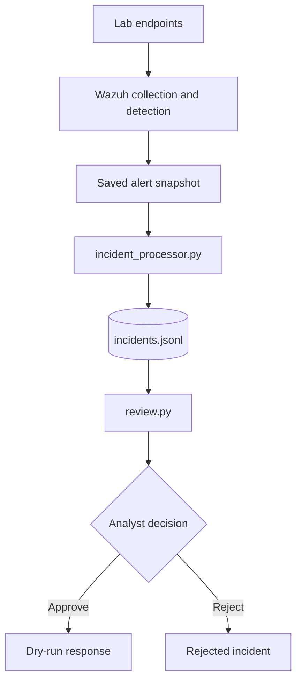

# AegisSOC Architecture

## Overview

AegisSOC is a lab-based security incident processing and analyst-review
prototype using Wazuh telemetry and Python scripts.

## Data flow

## Components

- **Wazuh:** Collects endpoint telemetry and evaluates detection rules.
- **Suricata:** Provides network monitoring in the lab.
- **pfSense:** Serves as the virtual firewall for configured traffic filtering and network-boundary control in the lab. Forwarding pfSense firewall logs to Wazuh is not documented as validated.
- **alerts_snapshot.json:** Saved alert input in JSON Lines format.
- **incident_processor.py:** Processes eligible alert records into incidents.
- **incidents.jsonl:** Stores structured incident history.
- **review.py:** Supports incident listing and analyst review actions.
- **Dry-run response:** Simulates the approved workflow without changing
  system or network settings.

## Validation status

The incident history currently contains 523 parseable records. Revalidate current incident ID uniqueness before claiming there are no duplicates. The saved alert snapshot is an input file, not proof of continuous real-time processing.

Windows Event ID 4625 triggered custom rule 100102 on October 22, 2026. A fresh alert confirming the updated MITRE mapping and a threshold trigger for rule 100101 remain unverified.

## Limitations

This is a lab prototype, not a production SOC platform. The demonstrated
response workflow is dry-run only. Do not claim live endpoint isolation,
network blocking, or validated AI-based detection without separate
implementation and testing.
